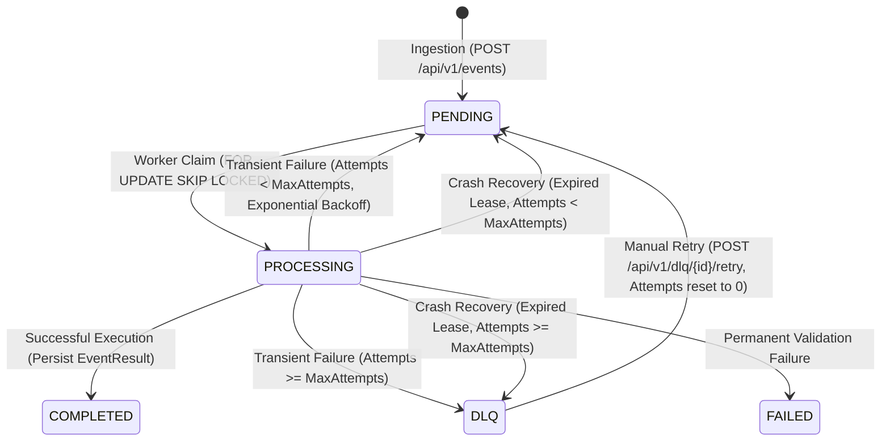

# Distributed Event Processing and Audit Platform

A high-throughput, resilient distributed event processing and audit backend platform built with **Java 21**, **Spring Boot 4.1.2**, **PostgreSQL 17/18**, and **Flyway**.

The platform ingests heterogeneous events over a REST API with strict idempotency guarantees, persists them in PostgreSQL, and processes them asynchronously using a concurrent worker pool. It features priority-based event selection with database-level row locking (`FOR UPDATE SKIP LOCKED`), configurable exponential backoff with integer overflow protection, semantic failure classification, Dead-Letter Queue (DLQ) management with race-safe manual retries, worker crash recovery with lease fencing, and a comprehensive audit trail.

---

## Table of Contents

- [Core Capabilities](#core-capabilities)
- [Architecture & Processing Lifecycle](#architecture--processing-lifecycle)
- [Technology Stack](#technology-stack)
- [Database Schema & Migrations](#database-schema--migrations)
- [REST API Reference](#rest-api-reference)
- [Configuration Reference](#configuration-reference)
- [Quickstart & Local Setup](#quickstart--local-setup)
- [Running Automated Tests](#running-automated-tests)
- [Worker Concurrency & Crash Recovery](#worker-concurrency--crash-recovery)

---

## Core Capabilities

1. **Idempotent Ingestion (`POST /api/v1/events`):**
   - Requires an `Idempotency-Key` HTTP header.
   - Replaying identical requests returns `200 OK` with the existing event record without creating duplicates.
   - Reusing an idempotency key with conflicting request content returns `409 Conflict`.
2. **Priority-Based Asynchronous Workers:**
   - Multi-threaded worker pool (`SmartLifecycle`) polling pending events in batches.
   - Priority scheduling (`HIGH` > `NORMAL` > `LOW`) with FIFO ordering (`created_at ASC`) as tie-breaker.
   - PostgreSQL row-level locking (`FOR UPDATE SKIP LOCKED`) ensures concurrent workers never claim or process the same event simultaneously.
3. **Persisted Results & Business Processors:**
   - Simulated business operations for:
     - `ORDER_PLACED`: Validates order/customer payload and generates confirmation + fulfillment dispatch.
     - `EMAIL_REQUESTED`: Validates email syntax and simulates transactional message delivery.
     - `PAYMENT_RECEIVED`: Validates amount/currency and simulates gateway settlement.
   - Idempotently persists processing output to `event_results` with database-enforced unique constraints (`uq_event_results_event_id`).
4. **Intelligent Retry Engine & Exponential Backoff:**
   - Exponential backoff formula: $\min(\text{baseDelay} \times 2^{\text{attemptCount} - 1}, \text{maxDelay})$.
   - Safe bitshift capping (`Math.min(attemptCount - 1, 30)`) eliminates integer overflow vulnerabilities.
   - Events are only eligible for worker claims once `next_attempt_at <= now()`.
5. **Semantic Failure Classification:**
   - **Permanent Failures:** Deterministic schema validation errors, missing required fields, invalid email syntax, or unsupported event types transition immediately to `FAILED` without retries.
   - **Retryable Failures:** Transient infrastructure, network, or downstream service errors increment attempt counters and reschedule with exponential backoff until attempts are exhausted.
6. **Dead-Letter Queue (DLQ) & Atomic Manual Retries:**
   - Exhausted retryable events automatically route to `DLQ`.
   - Dedicated REST APIs to inspect paginated DLQ items (`GET /api/v1/dlq`) and retrieve full failure diagnostics (`GET /api/v1/dlq/{eventId}`).
   - Atomic manual retry endpoint (`POST /api/v1/dlq/{eventId}/retry`) resets the attempt counter to 0, sets status back to `PENDING`, and prevents duplicate concurrent manual retry requests.
7. **Worker Crash Recovery & Stale Worker Fencing:**
   - Workers claim events with a time-bounded lease (`processing_lease_until`) and a unique optimistic claim token (`claim_token UUID`).
   - If a worker crashes or terminates unexpectedly, a background recovery coordinator identifies expired leases and requeues them safely.
   - If a stalled worker wakes up after lease expiry, fence-token validation rejects its commit attempt (`StaleClaimException`), preventing split-brain overwriting.
8. **End-to-End Audit Trail:**
   - Every state transition (`PENDING` $\rightarrow$ `PROCESSING` $\rightarrow$ `COMPLETED` / `FAILED` / `DLQ`) is appended to `event_audit_logs` with timestamps, worker IDs, attempt numbers, and descriptive diagnostic messages.

---

## Architecture & Processing Lifecycle



---

## Technology Stack

- **Runtime:** Java 21 (LTS)
- **Framework:** Spring Boot 4.1.2
- **Persistence:** Spring Data JPA / Hibernate 7
- **Database:** PostgreSQL 17/18 (PostgreSQL Alpine image via Docker Compose)
- **Migrations:** Flyway 12.4.0 (`flyway-core` + `flyway-database-postgresql`)
- **JSON Processing:** Jackson Tools 3.x with native PostgreSQL `jsonb` support
- **Testing:** JUnit 5, Mockito, Spring Boot Test, Testcontainers PostgreSQL 2.x
- **Containerization:** Docker Compose

---

## Database Schema & Migrations

The database schema is managed via versioned Flyway migrations under `src/main/resources/db/migration`:

| Migration | Description | Key Schema Elements |
|---|---|---|
| [`V1__create_events_table.sql`](file:///c:/projects/event_manager/event-driven/event-driven/src/main/resources/db/migration/V1__create_events_table.sql) | Core events table | `events` table with UUID PK, PostgreSQL enums `event_status` (`PENDING`, `PROCESSING`, `COMPLETED`, `FAILED`, `DLQ`) and `event_priority` (`LOW`, `NORMAL`, `HIGH`), JSONB `payload`, unique constraint on `idempotency_key`. |
| [`V2__create_event_results_table.sql`](file:///c:/projects/event_manager/event-driven/event-driven/src/main/resources/db/migration/V2__create_event_results_table.sql) | Execution results | `event_results` table storing processing output, worker ID, execution timestamp, and `UNIQUE(event_id)` constraint. |
| [`V3__create_event_audit_logs_table.sql`](file:///c:/projects/event_manager/event-driven/event-driven/src/main/resources/db/migration/V3__create_event_audit_logs_table.sql) | Audit logging | `event_audit_logs` table recording all lifecycle transitions, attempt numbers, and diagnostic messages with `(event_id, occurred_at)` index. |
| [`V4__add_event_processing_recovery.sql`](file:///c:/projects/event_manager/event-driven/event-driven/src/main/resources/db/migration/V4__add_event_processing_recovery.sql) | Crash recovery & lease fencing | Adds `claim_token UUID` and `processing_lease_until TIMESTAMPTZ` to `events`, plus partial indexes for lease expiration and DLQ lookups. |

---

## REST API Reference

All REST endpoints operate under the base path `/api/v1`.

### 1. Submit Event
- **Method:** `POST /api/v1/events`
- **Headers:**
  - `Content-Type: application/json`
  - `Idempotency-Key: <unique-string>` (Required)
- **Request Body:**
  ```json
  {
    "eventType": "ORDER_PLACED",
    "payload": {
      "orderId": "ORD-10023",
      "customerId": "CUST-849",
      "amount": 249.99
    },
    "priority": "HIGH"
  }
  ```
  *(Supported priorities: `LOW`, `NORMAL`, `HIGH`. Defaults to `NORMAL` if omitted).*
- **Responses:**
  - `201 Created` (New event accepted):
    ```json
    {
      "id": "e4588729-c439-4d82-8bc1-6f4882e361a9",
      "idempotencyKey": "order-submit-10023",
      "eventType": "ORDER_PLACED",
      "payload": { "orderId": "ORD-10023", "customerId": "CUST-849", "amount": 249.99 },
      "priority": "HIGH",
      "status": "PENDING",
      "attemptCount": 0,
      "maxAttempts": 5,
      "nextAttemptAt": null,
      "lastFailureReason": null,
      "createdAt": "2026-10-24T22:00:00Z",
      "updatedAt": "2026-10-24T22:00:00Z"
    }
    ```
  - `200 OK` (Duplicate idempotent submission with identical content returned).
  - `409 Conflict` (Idempotency key reused with different request payload or priority).
  - `400 Bad Request` (Missing required header, blank event type, or missing payload).

---

### 2. Retrieve Event Details
- **Method:** `GET /api/v1/events/{id}`
- **Responses:**
  - `200 OK`: Returns the event representation and current status (`PENDING`, `PROCESSING`, `COMPLETED`, `FAILED`, `DLQ`).
  - `404 Not Found`: Event ID does not exist.
  - `400 Bad Request`: Invalid UUID syntax.

---

### 3. List Dead-Letter Queue (DLQ) Events
- **Method:** `GET /api/v1/dlq?page=0&size=20&sort=updatedAt,desc`
- **Responses:**
  - `200 OK`: Paginated list of events currently in `DLQ` status:
    ```json
    {
      "content": [
        {
          "id": "1fa0d4cb-3bf4-4f05-aa50-c83756774e12",
          "idempotencyKey": "key-transient-99",
          "eventType": "PAYMENT_RECEIVED",
          "priority": "NORMAL",
          "status": "DLQ",
          "attemptCount": 5,
          "maxAttempts": 5,
          "lastFailureReason": "Downstream payment gateway connection timeout",
          "createdAt": "2026-10-24T21:45:00Z",
          "updatedAt": "2026-10-24T21:48:15Z"
        }
      ],
      "pageNumber": 0,
      "pageSize": 20,
      "totalElements": 1,
      "totalPages": 1,
      "last": true
    }
    ```

---

### 4. Retrieve Single DLQ Event Details
- **Method:** `GET /api/v1/dlq/{eventId}`
- **Responses:**
  - `200 OK`: Full event details and last failure reason.
  - `404 Not Found`: Event does not exist or is not in `DLQ` status.

---

### 5. Manually Retry a DLQ Event
- **Method:** `POST /api/v1/dlq/{eventId}/retry`
- **Behavior:**
  - Atomically validates the event is in `DLQ` status.
  - Resets `attempt_count` to 0.
  - Clears `next_attempt_at`, `claim_token`, and `processing_lease_until`.
  - Transitions status to `PENDING` for immediate processing by the next worker batch.
  - Logs a manual retry entry in the audit trail.
- **Responses:**
  - `200 OK`: Returns updated event in `PENDING` status.
  - `409 Conflict`: Event is already `COMPLETED` or `FAILED`, or a concurrent retry call was accepted first.
  - `404 Not Found`: Event does not exist.

---

### 6. Health Check
- **Method:** `GET /actuator/health`
- **Response:**
  - `200 OK`:
    ```json
    {
      "status": "UP"
    }
    ```

---

## Configuration Reference

All settings can be configured via `application.properties` or overridden via environment variables in `.env`:

| Property | Environment Variable | Default | Description |
|---|---|---|---|
| `server.port` | `SERVER_PORT` | `8080` | HTTP application port |
| `spring.datasource.url` | `DB_HOST`, `DB_PORT`, `DB_NAME` | `localhost:5432/event_platform` | PostgreSQL JDBC connection URL |
| `spring.datasource.username` | `DB_USERNAME` | `event_app` | Dedicated database username |
| `spring.datasource.password` | `DB_PASSWORD` | — | Database user password |
| `spring.datasource.hikari.maximum-pool-size` | `DB_POOL_SIZE` | `10` | HikariCP database connection pool size |
| `app.worker.enabled` | `WORKER_ENABLED` | `true` | Enable or disable background worker execution |
| `app.worker.concurrency` | `WORKER_CONCURRENCY` | `3` | Number of concurrent worker threads |
| `app.worker.polling-interval-ms` | `WORKER_POLLING_INTERVAL_MS` | `1000` | Worker polling interval in milliseconds |
| `app.worker.batch-size` | `WORKER_BATCH_SIZE` | `5` | Maximum number of events claimed per batch |
| `app.retry.enabled` | `RETRY_ENABLED` | `true` | Enable or disable automatic retries |
| `app.retry.default-max-attempts` | `RETRY_DEFAULT_MAX_ATTEMPTS` | `5` | Maximum processing attempts before DLQ routing |
| `app.retry.base-delay` | `RETRY_BASE_DELAY` | `1s` | Initial exponential backoff delay |
| `app.retry.max-delay` | `RETRY_MAX_DELAY` | `60s` | Maximum delay cap for exponential backoff |
| `app.retry.lease-duration` | `RETRY_LEASE_DURATION` | `30s` | Worker claim lease timeout before crash recovery |
| `app.retry.recovery-enabled` | `RETRY_RECOVERY_ENABLED` | `true` | Enable background crash recovery scanner |
| `app.retry.recovery-interval` | `RETRY_RECOVERY_INTERVAL` | `5s` | Crash recovery scan interval |

---

## Quickstart & Local Setup

### Prerequisites
- **Java 21** or higher
- **Docker** and **Docker Compose**

### Step 1: Clone and Configure Environment
```bash
cd event-driven

# Copy sample environment configuration
cp .env.example .env

# Edit .env with your desired database credentials
```

### Step 2: Start PostgreSQL with Docker Compose
```bash
docker compose up -d
```
*This starts PostgreSQL 17 on port 5432 with a persistent named volume and executes the initialization script creating the dedicated application user and database.*

### Step 3: Run the Application
```bash
./mvnw spring-boot:run
```
*(On Windows: `.\mvnw.cmd spring-boot:run`)*

Flyway will automatically execute migrations `V1` through `V4`, and the application will start on `http://localhost:8080`.

---

## Running Automated Tests

The platform contains an automated integration test suite running against real PostgreSQL databases.

```bash
# Execute entire test suite
./mvnw clean test
```
*(On Windows: `.\mvnw.cmd clean test`)*

### Verified Test Scenarios (34 Tests, 100% Pass)
- **Ingestion & Idempotency:** Submissions, priority defaulting, validation errors, duplicate repeated payloads, payload conflicts, and priority conflicts.
- **Worker Concurrency:** High-concurrency claiming with zero collisions across 10 threads, `FOR UPDATE SKIP LOCKED` lock exclusion, and priority order enforcement (`HIGH` > `NORMAL` > `LOW`).
- **Retry Engine & Backoff:** Exponential backoff doubling, max delay cap saturation (60s), integer overflow safety, and non-claiming of future retries.
- **DLQ & Manual Retries:** Routing to DLQ after attempt exhaustion, DLQ listing and inspection, atomic manual requeuing, rejection of invalid states, and duplicate retry deduplication.
- **Crash Recovery & Fencing:** Safe recovery of expired `PROCESSING` claims, and prevention of stale workers from committing results or overwriting new claims.

---

## Worker Concurrency & Crash Recovery

### Row-Level Locking (`FOR UPDATE SKIP LOCKED`)
Event claiming is executed in an isolated, short transaction (`Propagation.REQUIRES_NEW`):
```sql
SELECT * FROM events
WHERE status = 'PENDING'
  AND (next_attempt_at IS NULL OR next_attempt_at <= now())
ORDER BY priority DESC, created_at ASC
LIMIT :limit
FOR UPDATE SKIP LOCKED;
```
Once claimed, the status is updated to `PROCESSING`, a `claim_token UUID` is generated, `processing_lease_until` is stamped, and the transaction commits immediately. This releases the row-level lock so database connections are never held during external processing or business logic.

### Crash Recovery and Fence Tokens
If a worker crashes or hangs:
1. `EventRecoveryManager` scans for events stranded in `PROCESSING` where `processing_lease_until <= now()`.
2. Expired events are safely recovered: moved back to `PENDING` (or `DLQ` if attempts are exhausted) with their claim tokens cleared.
3. If the original stalled worker awakens, any attempt to finalize the event checks `claim_token.equals(expectedClaimToken)`. Because the token has changed, a `StaleClaimException` is thrown, blocking split-brain overwrites and duplicate results.
